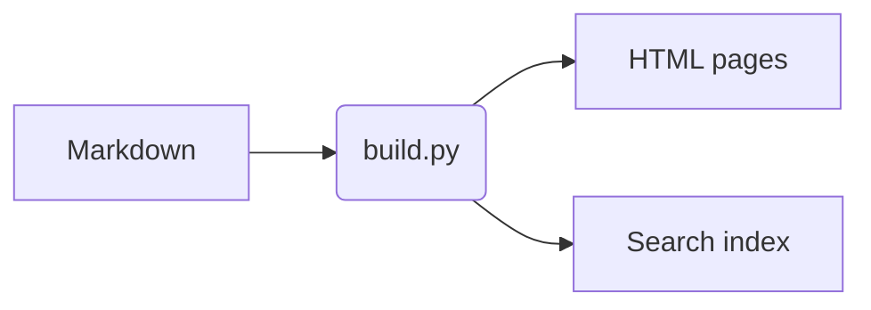

# Embeds & includes

Directives go on a line of their own. Inside fenced code blocks they are never executed, which is how this page can show you the syntax.

## Embeds

```text

```

Result:



The URL decides how it is embedded:

| URL                                   | Rendered as                       |
| ------------------------------------- | --------------------------------- |
| YouTube / `youtu.be`                  | privacy-friendly YouTube player   |
| Vimeo, CodePen                        | their embed players               |
| `.mp4`, `.webm`, `.mov`               | HTML5 video                       |
| `.mp3`, `.wav`, `.ogg`                | HTML5 audio                       |
| `.pdf`                                | inline PDF viewer                 |
| local `.html` or any other `https://` | `<iframe>`                        |

Options: `title`, `caption`, `ratio="4/3"` and `height="480"`.

### A local interactive page

Put the file anywhere in `docs/` (here `assets/demo.html`) and point to it with a relative path:

```text

```



## Includes

Reuse a Markdown partial in several pages. The path is relative to the current file, or to `docs/`:

```text

```



The `--8<-- "file"` form used by MkDocs snippets works too.

### Include source files as code

Any non-Markdown file is inserted as a highlighted code block. Add `lines="3-8"` to show only part of it:

```text

```



## Diagrams

A fenced `mermaid` block becomes a diagram (the page loads Mermaid from a CDN, so it needs internet access):


